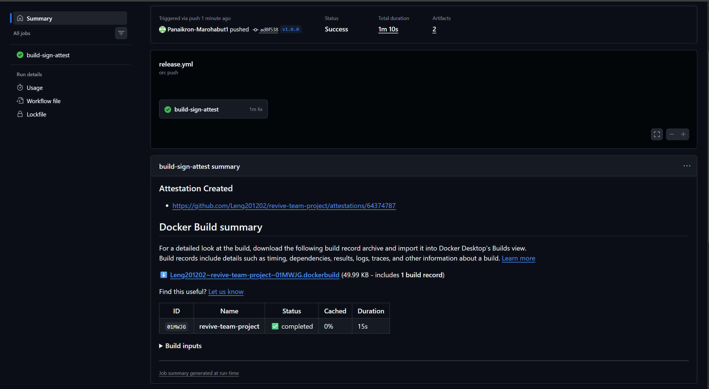

# Term Project Report — Secure Build

> Fill in every section. Keep the headings. Total **100 pts** (see rubric at the end).
> This is **team work** (2–3). Do not share your report with other teams.

## Cover

| Field | Value |
|---|---|
| Team name | REVIVE |
| Members (name + ID) | Panaikron Marohabut (6631503126), Sai Shang Hlang (6631503129), Zaw Phyo Aung (6631503130) |
| Target application | NoteVault (Python/Flask) |
| Repository URL | https://github.com/Leng201202/revive-team-project |
| Demo video URL | https://drive.google.com/drive/folders/16AqdnTP3pqreXMjkiBqHHQrdOx-edOY5 |
| Date | 6 November 2026 |

## AI-tool usage disclosure
*Academic integrity: state how you used any AI tools (ChatGPT, Copilot, etc.) — e.g. searching, coding, translating, drafting. "None" is a valid answer.*

| Tool | How it was used |
|---|---|
| OpenAI Codex | Repository audit, code-remediation assistance, regression-test drafting, CI/SBOM workflow drafting, and report editing. The team remains responsible for reviewing the code, running the demo, and verifying every submitted claim. |

---

## 1. Executive Summary

NoteVault is a Python/Flask note-taking application with JWT cookie sessions,
SQLite storage, an admin API, search, and note export. Testing of the supplied
baseline identified **19 findings: 3 Critical, 10 High, 5 Medium, and 1 Low**.
The most serious paths allowed unauthenticated SQL-injection login bypass,
database extraction, admin-token forgery, and authenticated OS command
execution as root. Several weaker controls—MD5 password storage, missing
cookie flags, stored XSS, and excessive admin data—made those primary attacks
substantially more damaging.

The remediation branch removes shell execution, parameterizes every query,
enforces ownership and server-selected roles, escapes untrusted output, uses
Werkzeug's salted slow password KDF, and issues short-lived revocable JWTs from
a runtime-only secret. It adds CSRF protection, login throttling, security
headers, audit events, non-destructive persistent database initialization, and
21 regression tests. The build now uses hash-locked current dependencies, a
digest-pinned base image, a non-root/read-only container, a CycloneDX SBOM, and
CI gates for SAST, SCA, secret scanning, and HIGH/CRITICAL container findings.
Residual deployment risks are TLS termination, the single-process in-memory
rate limiter, and completion of the external GitHub tag/sign/video steps.

---

## 2. System Scope & Function

NoteVault is a small team note-sharing web app + JSON API (single Flask process,
SQLite storage, one Docker container, plain HTTP on port 8080). It provides
registration/login with a JWT session cookie, per-user note creation and
search, a JSON note endpoint, an admin panel listing all users, and an
"export" convenience endpoint backed by a shell command.

**In-scope components and endpoints:**

- `POST /register`, `POST /login`, `GET /logout` — auth & session issuing (P1)
- `GET /`, `POST /notes` — note list and creation (P2)
- `GET /search` — per-user note search (P3)
- `GET /admin` — admin panel, dumps the users table (P4)
- `GET /export` — shell-backed export stub (P5 → OS shell)
- `GET /api/notes/<id>` — JSON note fetch (P6)
- Data stores: SQLite `/tmp/notevault.db` (`users`, `notes`), `session` JWT
  cookie, process env / config (`APP_SECRET`, `TEAM_ID`, `TEAM_SALT`, source
  constant `SECRET`)
- Build/runtime: `Dockerfile`, `docker-compose.yml`, `requirements.txt`

**Data-Flow Diagram (DFD):** full version with element/flow tables in
[`threat-model/02-dataflow.md`](threat-model/02-dataflow.md). A plain-language narrative of
every identified problem — before any formal modelling — is in
[`threat-model/01-problems.md`](threat-model/01-problems.md) (each entry links back
to its DFD element and STRIDE row).


**Trust boundaries:** 
- TB1 = client ↔ server (F1, F3, F7-input, F9)  
- TB2 = app ↔ SQLite (F4–F6) 
- TB3 = app ↔ OS shell (F7) 
- TB4 = container ↔ host/image (F8, runtime config).

---

## 3. Threat Model — STRIDE  *(20 pts)*

Full write-up in [`threat-model/03-stride.md`](threat-model/03-stride.md).

| Element / data flow | S | T | R | I | D | E | Top threat & mitigation |
|---|---|---|---|---|---|---|---|
| `F1 (TB1)` — login/register credentials in transit | ✓ | | | ✓ | | | Sniffed credentials over plaintext HTTP → TLS |
| `P1 / F1 (TB1)` — `/login` rate & resource limits | ✓ | | | | ✓ | | Brute force + resource exhaustion → rate limit, lockout, size caps |
| `P1 / F5 (TB2)` — auth logic (`/login`, `/register`) | ✓ | ✓ | | | | ✓ | SQLi bypass + client-set `role` + duplicate `admin` (no UNIQUE) → parameterised queries, fixed role, constraint |
| `D3 / F2–F3 (TB1)` — session JWT cookie | ✓ | ✓ | | ✓ | | ✓ | `alg=none` whitelisted + hardcoded secret → forgery; no `exp` → no expiry/revocation; no flags → XSS theft. Pin HS256, env secret, `exp`/`aud`, flags |
| `P2 / F4 (TB2)` — notes create/render (`GET /`, `POST /notes`) | | ✓ | | ✓ | | | Stored XSS via `notes_html\|safe` → output encoding, CSP |
| `P6 / F4 (TB2)` — `GET /api/notes/<id>` | | | | ✓ | | | IDOR/BOLA — no owner check → enforce `owner = current_user` |
| `P3 / F4 (TB2)` — `GET /search` | | ✓ | | ✓ | | | SQLi via `q` → parameterised LIKE |
| `P4 / F6 / F9 (TB1–TB2)` — `GET /admin` | | | | ✓ | | | Excessive data exposure — all MD5 hashes → never return hashes; strong KDF |
| `P5 → P7 / F7 (TB3)` — `/export` → OS shell | | ✓ | | ✓ | ✓ | ✓ | Command injection via `fmt` → RCE + DoS. Drop `shell=True`, whitelist |
| `D1 / D2 (TB2)` — SQLite store (`users`, `notes`) | | ✓ | | ✓ | ✓ | | Tamper/dump via SQLi; `seed()` wipes data each restart → least-privilege FS, persistent volume |
| `D1` — `users` password store (MD5, no salt) | | | | ✓ | | | Offline cracking → slow salted KDF (`scrypt`/argon2/bcrypt) |
| `P0 / D4 / F8 (TB4)` — Container & runtime (`Dockerfile`, `debug=True`) | | | | ✓ | | ✓ | Root + baked secret + unpinned base + debugger → non-root, runtime secrets, pin, debug off |

*Global note: there is no logging anywhere, so Repudiation applies to every
flow in principle; we call it out where it matters most.*

**Top 5 risks (likelihood × impact):**

1. **RCE via `/export?fmt=`** — High × Critical. `shell=True` with unvalidated
   input runs commands as root in the container; exposes env secrets.
2. **SQL injection (login bypass + `/search` UNION dump)** — High × Critical.
   String-formatted queries allow auth bypass and dumping every user's
   credentials and every note.
3. **JWT session forgery via the hardcoded weak secret** — High × High. The
   committed key lets an attacker mint an admin HS256 token. Although `none`
   was incorrectly allow-listed, PyJWT 1.7.1 rejected the tested unsigned token.
4. **Privilege escalation via mass-assigned `role` on `/register`** — High ×
   High. Self-provisioned admin reaches the full user/hash dump.
5. **IDOR on `GET /api/notes/<id>`** — High × Medium–High. Sequential ids with
   no ownership check expose every user's private notes.

---

## 4. Vulnerability Findings  *(25 pts)*

All findings verified live against the Docker container
(`revive-team-project-notevault-1`, `TEAM_ID=REVIVE`) — see
`threat-model/01-problems.md` for plain-language explanations and
`evidence/` for artifacts.

**Numbering note.** Threat-model problems (`P-XX`, 20 total) are ordered by
category in `01-problems.md`; findings (`F-XX`, 19 total) are ordered by
severity/discovery. Every problem maps to exactly one finding; F-10 covers two
problems. Full mapping:

| Problem ID | Problem Description (Threat Model) | Mapped Finding | Severity |
|---|---|---|---|
| `P-01` | Self-made admin at signup (`role=admin` mass assignment on `/register`) | `F-04` | High |
| `P-02` | Duplicate `admin` registration allowed (no `UNIQUE` constraint on `username`) | `F-05` | High |
| `P-03` | Forged JWT session token via hardcoded `SECRET` in source code | `F-06` | High |
| `P-04` | SQL injection authentication bypass on `POST /login` | `F-02` | Critical |
| `P-05` | IDOR / BOLA — read other users' private notes via `GET /api/notes/<id>` | `F-07` | High |
| `P-06` | SQL injection UNION query dumps entire `users` table via `GET /search` | `F-03` | Critical |
| `P-07` | Excessive data exposure — `GET /admin` returns all users' password hashes | `F-08` | High |
| `P-08` | OS command injection (RCE as root) via `GET /export?fmt=` with `shell=True` | `F-01` | Critical |
| `P-09` | Stored XSS in note title/body via `notes_html\|safe` | `F-09` | High |
| `P-10` | Passwords hashed with fast, unsalted MD5 | `F-18` | High |
| `P-11` | Unlimited password guesses — no rate limiting or lockout on `/login` | `F-11` | Medium |
| `P-12` | JWT session token never expires (`no exp`) and logout cannot revoke it | `F-10` | Medium |
| `P-13` | Session cookie missing `HttpOnly`, `Secure`, and `SameSite` flags | `F-10` | Medium |
| `P-14` | Plaintext HTTP transport (no TLS termination) | `F-19` | Medium |
| `P-15` | No CSRF tokens or `Origin`/`Referer` validation on state-changing POSTs | `F-12` | Medium |
| `P-16` | Flask `debug=True` enabled in container (Werkzeug debugger exposure) | `F-13` | High |
| `P-17` | Dockerfile misconfigurations (runs as root, baked secret, unpinned base/pip) | `F-15` | High |
| `P-18` | Outdated dependencies in `requirements.txt` with 81 known CVEs | `F-14` | High |
| `P-19` | No security logging or audit trail anywhere in the application | `F-16` | Medium |
| `P-20` | `seed()` unconditionally drops and recreates tables on every restart | `F-17` | Low |

### Finding F-01 — OS command injection via `/export?fmt=` (RCE as root)
| Field | Value |
|---|---|
| CWE | CWE-78 (OS Command Injection) |
| OWASP 2025 | A05 (Injection) |
| Severity | Critical |
| Location | `app.py:202-203`, `GET /export` |
| Reproduction | `GET /export?fmt=txt;id` → `uid=0(root)`; `fmt=txt;cat /etc/passwd` dumps passwd; `fmt=txt;env` leaks `APP_SECRET`, `TEAM_ID`, `TEAM_SALT` |
| Impact | Arbitrary commands as **root** in the container; env-secret theft enables offline JWT minting (attack chain 3) |
| Evidence |  |

### Finding F-02 — SQL injection: authentication bypass on `/login`
| Field | Value |
|---|---|
| CWE | CWE-89 (SQL Injection) |
| OWASP 2025 | A05 (Injection) |
| Severity | Critical |
| Location | `app.py:128-129`, `POST /login` |
| Reproduction | `POST /login` with `username=alice'--` and any `password` → `302` + session cookie issued |
| Impact | Login as any user without credentials |
| Evidence |  |

### Finding F-03 — SQL injection: UNION dump via `/search`
| Field | Value |
|---|---|
| CWE | CWE-89 (SQL Injection) |
| OWASP 2025 | A05 (Injection) |
| Severity | Critical |
| Location | `app.py:178`, `GET /search?q=` |
| Reproduction | `GET /search?q=' UNION SELECT id,username,password FROM users--` returns every user's MD5 hash as "search results" |
| Impact | Full `users` table exfiltration (all password hashes) |
| Evidence |  |

### Finding F-04 — Privilege escalation via mass-assigned `role` on `/register`
| Field | Value |
|---|---|
| CWE | CWE-915 (Mass Assignment) / CWE-266 (Incorrect Privilege Assignment) |
| OWASP 2025 | A01 (Broken Access Control) + API3 (Broken Object Property Level Authorization) |
| Severity | High |
| Location | `app.py:114`, `POST /register` |
| Reproduction | `POST /register` with `username=mallory&password=pw123&role=admin` → new account reaches `/admin` |
| Impact | Self-provisioned admin account — persistent full access |
| Evidence |  |

### Finding F-05 — Duplicate `admin` registration (no UNIQUE constraint)
| Field | Value |
|---|---|
| CWE | CWE-269 (Improper Privilege Management) |
| OWASP 2025 | A01 (Broken Access Control) |
| Severity | High |
| Location | `app.py:64` (schema), `app.py:91` (`role_of()`) |
| Reproduction | Re-register `admin`/`myownpw` → login with own password → `role_of()` returns the *real* admin's role → `/admin` access |
| Impact | Privilege escalation without touching `role` field |
| Evidence |  |

### Finding F-06 — JWT forgery via hardcoded `SECRET`
| Field | Value |
|---|---|
| CWE | CWE-321 (Hard-coded Cryptographic Key) / CWE-347 (Improper Signature Verification) |
| OWASP 2025 | A07 (Authentication Failures) |
| Severity | High |
| Location | `app.py:23,83` |
| Reproduction | `jwt.encode({'sub':'admin'}, 'notevault-dev-secret', algorithm='HS256')` → forged cookie reaches `/admin`. (Note: `alg=none` is whitelisted but blocked by PyJWT 1.7.1's key-guard — the working attack is key theft.) |
| Impact | Impersonate any user without credentials |
| Evidence |  |

### Finding F-07 — IDOR on `GET /api/notes/<id>`
| Field | Value |
|---|---|
| CWE | CWE-639 (IDOR / User-Controlled Key Authorization Bypass) |
| OWASP 2025 | A01 (Broken Access Control) + API1 (Broken Object Level Authorization) |
| Severity | High |
| Location | `app.py:163-166` |
| Reproduction | As `alice`: `GET /api/notes/2` → admin's `infra` note ("prod db password is hunter2"); `/api/notes/3` → `build-tag` marker |
| Impact | Read every user's private notes incl. admin secrets |
| Evidence |  |

### Finding F-08 — Excessive data exposure on `/admin`
| Field | Value |
|---|---|
| CWE | CWE-200 (Sensitive Information Exposure) / CWE-359 (Private Information Exposure) |
| OWASP 2025 | API3 (Broken Object Property Level Authorization) |
| Severity | High |
| Location | `app.py:191` |
| Reproduction | Any admin-reachable path (F-04/05/06) → `GET /admin` returns `password` column (MD5 hashes) for all users |
| Impact | Every password hash leaks through an official endpoint |
| Evidence |  |

### Finding F-09 — Stored XSS in note title/body
| Field | Value |
|---|---|
| CWE | CWE-79 (Cross-site Scripting — XSS) |
| OWASP 2025 | A05 (Injection) |
| Severity | High |
| Location | `app.py:43,104-106,181-182` (`notes_html\|safe`) |
| Reproduction | `POST /notes` with `body=<script>alert(document.cookie)</script>` → every viewer executes it; cookie readable (no HttpOnly) |
| Impact | Session theft of any viewer incl. admin (chains with F-10) |
| Evidence |  |

### Finding F-10 — Session cookie missing flags + JWT never expires
| Field | Value |
|---|---|
| CWE | CWE-1004 (Cookie Without HttpOnly) / CWE-614 (Cookie Without Secure) / CWE-613 (Insufficient Session Expiration) |
| OWASP 2025 | A05 (Injection) / A07 (Authentication Failures) |
| Severity | Medium |
| Location | `app.py:134,136` |
| Reproduction | `Set-Cookie: session=…; Path=/` — no `HttpOnly`, `Secure`, `SameSite`; payload `{"sub":"alice"}` has no `exp`/`aud`; logout deletes only the client copy |
| Impact | XSS→instant session theft; stolen tokens work forever |
| Evidence |  |

### Finding F-11 — No rate limiting / lockout
| Field | Value |
|---|---|
| CWE | CWE-307 (Brute-Force / Excessive Auth Attempts) |
| OWASP 2025 | API4 (Unrestricted Resource Consumption) |
| Severity | Medium |
| Location | `app.py:123-137`, `POST /login` |
| Reproduction | 30+ rapid failed logins → all `401`, no delay or lockout |
| Impact | Online password brute force; unbounded resource use |
| Evidence |  |

### Finding F-12 — No CSRF protection
| Field | Value |
|---|---|
| CWE | CWE-352 (Cross-Site Request Forgery — CSRF) |
| OWASP 2025 | A01 (Broken Access Control) |
| Severity | Medium |
| Location | `app.py:147-155` (`/notes`, `/login`, `/register`) |
| Reproduction | `POST /notes` with `Origin: http://evil.example` → `302` accepted; no token or Origin/Referer check |
| Impact | Third-party pages can act as any logged-in user |
| Evidence |  |

### Finding F-13 — `debug=True` → Werkzeug debugger exposure
| Field | Value |
|---|---|
| CWE | CWE-489 (Active Debug Code) / CWE-215 (Sensitive Info in Debug Output) |
| OWASP 2025 | A02 (Security Misconfiguration) |
| Severity | High |
| Location | `app.py:209` |
| Reproduction | `GET /search?q='` → `sqlite3.OperationalError` → full traceback page with interactive console ("execute arbitrary Python code") |
| Impact | Info disclosure by default; second RCE path via console (PIN in logs) |
| Evidence |  |

### Finding F-14 — Vulnerable dependencies (known CVEs)
| Field | Value |
|---|---|
| CWE | CWE-1395 (Vulnerable Third-Party Component) |
| OWASP 2025 | A03 (Software Supply Chain Failures) |
| Severity | High |
| Location | `requirements.txt` |
| Reproduction | `pip-audit -r requirements.txt` → **81 known vulnerabilities in 7 packages** (Flask 2.0.1, Werkzeug 2.0.1, Jinja2 3.0.1, PyJWT 1.7.1, requests 2.25.1, urllib3 1.26.4, idna 2.10) |
| Impact | Attackers use published exploits; no new bug needed |
| Evidence | `evidence/F-14.txt` |

### Finding F-15 — Dockerfile misconfigurations
| Field | Value |
|---|---|
| CWE | CWE-250 (Execution with Unnecessary Privileges) / CWE-798 (Hard-coded Credentials) / CWE-1357 (Unpinned / Untrusted Component) |
| OWASP 2025 | A02 (Security Misconfiguration) |
| Severity | High |
| Location | `Dockerfile` |
| Reproduction | `docker history` → `ENV APP_SECRET=notevault-dev-secret` visible in layer; `docker exec … whoami` → `root`; `FROM python:3.12` unpinned; `COPY . .` drags whole context; `pip install` without `--require-hashes` |
| Impact | Root compromise inside container; secret recoverable from image; unpinned supply chain |
| Evidence | `evidence/F-15.txt` |

### Finding F-16 — No logging or audit trail
| Field | Value |
|---|---|
| CWE | CWE-778 (Insufficient Logging) |
| OWASP 2025 | A09 (Security Logging and Alerting Failures) |
| Severity | Medium |
| Location | `app.py` (no `logging` anywhere) |
| Reproduction | After the full attack session, `docker logs` shows only werkzeug access lines — no auth events, no alerts, no audit |
| Impact | Breaches are invisible; repudiation impossible; no detection |
| Evidence | `evidence/F-16.txt` |

### Finding F-17 — `seed()` drops all data on every restart
| Field | Value |
|---|---|
| CWE | CWE-664 (Improper Resource Lifetime Control) |
| OWASP 2025 | A06 (Insecure Design) |
| Severity | Low |
| Location | `app.py:63,208` |
| Reproduction | `docker restart` → `/admin` shows only the 2 seed users; all registered accounts/notes gone |
| Impact | Anyone who can crash the app (or any ops restart) destroys all data |
| Evidence |  |

### Finding F-18 — Passwords stored with fast, unsalted MD5
| Field | Value |
|---|---|
| CWE | CWE-916 (Weak Password Hash Effort) / CWE-327 (Broken Cryptographic Algorithm) |
| OWASP 2025 | A04 (Cryptographic Failures) |
| Severity | High |
| Location | Baseline `app.py:68-69,117` |
| Reproduction | The baseline stores `hashlib.md5(password.encode()).hexdigest()`; known inputs reproduce the exact database hashes without a per-user salt |
| Impact | A database or admin-response leak becomes rapid offline password cracking; equal passwords also have equal hashes |
| Evidence | `evidence/F-18.txt` |

### Finding F-19 — Plain HTTP transport
| Field | Value |
|---|---|
| CWE | CWE-319 (Cleartext Transmission) |
| OWASP 2025 | A04 (Cryptographic Failures) |
| Severity | Medium |
| Location | Baseline `app.py:209`, `docker-compose.yml:5-6` |
| Reproduction | The Flask server listens without TLS on `http://0.0.0.0:8080`, and Compose publishes that port directly |
| Impact | A network-positioned attacker can observe or modify credentials, cookies, notes, and responses |
| Evidence | `evidence/F-19.txt` |

---

## 5. Remediation  *(25 pts)*

The changes are on `security-remediation`. Application controls and tests are
in commit `deb2381` (`F-01`–`F-13`, `F-16`–`F-19`). Dependency, container,
SBOM, CI, signing, and provenance controls are in `38ecdba` (`F-14`, `F-15`,
`F-17`, `F-19`). The table maps every finding to its regression proof.

### Representative before/after changes

#### F-01 — Remove the OS command interpreter

```diff
# --- BEFORE (Vulnerable: unvalidated shell execution) ---
- out = subprocess.run("echo exporting notes as " + fmt, shell=True, ...)

# +++ AFTER (Fixed: strict allow-list + parameterized query in Python) +++
+ if output_format not in {"txt", "json"}:
+     return "unsupported export format", 400
+ rows = get_db().execute("SELECT ... WHERE owner = ?", (current_user(),))
```

> **Why this fixes it:** No attacker input reaches a shell. Export formats are an exact allow-list and the response is generated in Python.

#### F-02/F-03 — Parameterize SQL

```diff
# --- BEFORE (Vulnerable: raw string interpolation) ---
- q = "SELECT * FROM users WHERE username = '%s' ..." % username
- row = con.execute(q).fetchone()

# +++ AFTER (Fixed: parameterized query with bound parameters) +++
+ row = get_db().execute(
+     "SELECT username, password_hash FROM users WHERE username = ?", (username,)
+ ).fetchone()
```

> **Why this fixes it:** Input remains data instead of becoming SQL grammar. Search also escapes the `LIKE` wildcard characters before using a bound parameter.

#### F-07 — Enforce object ownership in the query

```diff
# --- BEFORE (Vulnerable: no owner check) ---
- SELECT id,owner,title,body FROM notes WHERE id = ?

# +++ AFTER (Fixed: enforce authenticated owner) +++
+ SELECT id,owner,title,body FROM notes WHERE id = ? AND owner = ?
```

> **Why this fixes it:** The database returns a note only when both its identifier and authenticated owner match.

#### F-09 — Restore Jinja output encoding

```diff
# --- BEFORE (Vulnerable: autoescaping disabled via |safe) ---
- {{ notes_html|safe }}

# +++ AFTER (Fixed: automatic Jinja HTML escaping) +++
+ {{ note.title }}: {{ note.body }}
```

> **Why this fixes it:** Titles and bodies are passed as template data and automatically HTML-escaped; the CSP is a second layer of defense.

#### F-06/F-10 — Secure and bound the session

```diff
# --- BEFORE (Vulnerable: hardcoded secret, alg=none allowed, no claims/cookie flags) ---
- SECRET = "notevault-dev-secret"
- jwt.decode(token, SECRET, algorithms=["HS256", "none"])
- resp.set_cookie("session", token)

# +++ AFTER (Fixed: runtime secret, pinned HS256 + required claims, strict cookie flags) +++
+ jwt.decode(token, runtime_secret, algorithms=["HS256"],
+            audience="notevault-web", issuer="notevault",
+            options={"require": ["sub", "iat", "exp", "jti", "aud", "iss"]})
+ resp.set_cookie("session", token, httponly=True, secure=True,
+                 samesite="Strict", max_age=900)
```

> **Why this fixes it:** The key is supplied only at runtime, the algorithm and claims are pinned, each token expires after 15 minutes, logout stores its `jti` in a revocation table, and browser cookie controls reduce theft and cross-site use.

### Finding-to-fix traceability

| Finding | Vulnerability | Implemented control | Regression proof |
|---|---|---|---|
| `F-01` | OS command injection (`/export`) | Removed `subprocess` and `shell=True`; `txt/json` allow-list | `test_f01_export_command_injection_is_rejected` |
| `F-02` | SQLi login bypass (`/login`) | Parameterized login query and constant-time-style dummy hash check | `test_f02_login_sql_injection_fails` |
| `F-03` | SQLi UNION dump (`/search`) | Parameterized `LIKE`, escaped wildcards, fixed template | `test_f03_search_union_injection_fails` |
| `F-04` | Mass-assigned `role=admin` (`/register`) | Server always inserts role `user` | `test_f04_registration_ignores_attacker_role` |
| `F-05` | Duplicate `admin` registration | `UNIQUE COLLATE NOCASE` username constraint | `test_f05_duplicate_admin_registration_is_blocked` |
| `F-06` | JWT forgery via hardcoded `SECRET` | Runtime 32+ character key; HS256 only; required claims | `test_f06_forged_jwt_with_old_secret_is_rejected` |
| `F-07` | IDOR on `GET /api/notes/<id>` | Note query includes authenticated owner | `test_f07_idor_returns_not_found_for_another_users_note` |
| `F-08` | Excessive data exposure (`/admin` hashes) | Admin DTO selects only id, username, role | `test_f08_admin_response_excludes_password_hash` |
| `F-09` | Stored XSS in note title/body | Jinja autoescaping plus restrictive CSP | `test_f09_stored_xss_is_escaped` |
| `F-10` | Missing cookie flags + non-expiring JWT | 15-minute JWT, audience/issuer/JTI, revocation, cookie flags | `test_f10_session_has_flags_claims_and_logout_revokes` |
| `F-11` | No login rate limiting / lockout | Five failures/minute/IP limiter with 429/Retry-After | `test_f11_login_rate_limit_returns_429` |
| `F-12` | No CSRF protection on state-changing POSTs | Double-submit CSRF token and Origin validation on every POST | `test_f12_csrf_is_required_and_origin_checked` |
| `F-13` | `debug=True` Werkzeug debugger exposure | Gunicorn entry point, generic 500 response, debug disabled | `test_f13_debug_disabled_and_errors_are_generic` |
| `F-14` | Vulnerable dependencies (81 CVEs) | Current direct pins plus complete SHA-256 lockfile | `test_f14_dependencies_are_upgraded`; `pip-audit` clean |
| `F-15` | Dockerfile misconfigurations | Digest pin, non-root UID, read-only FS, dropped capabilities, narrow COPY | `test_f15_dockerfile_is_hardened` |
| `F-16` | No security logging or audit trail | Authentication, admin, CSRF, export, and note audit events | `test_f16_security_events_are_logged` |
| `F-17` | `seed()` drops all data on every restart | `CREATE TABLE IF NOT EXISTS`, seed only when empty, named volume | `test_f17_database_initialization_preserves_existing_data` |
| `F-18` | Unsalted fast MD5 password storage | Werkzeug salted `scrypt` password hashes | `test_weak_md5_password_storage_is_replaced` |
| `F-19` | Plaintext HTTP transport | Loopback-only container binding, Secure cookie and HSTS; TLS required at deployment edge | `test_security_headers_are_present`; deployment check |

Local verification on 3 November 2026: **21 tests passed**, Bandit reported
zero findings, and pip-audit reported **no known vulnerabilities**.

---

## 6. Supply-Chain Hardening  *(15 pts)*

- `requirements.lock` pins the complete production graph and includes SHA-256
  hashes. Docker installs it with `--require-hashes`.
- [`supply-chain/sbom.cdx.json`](supply-chain/sbom.cdx.json) is a validated,
  reproducible **CycloneDX 1.6** SBOM containing **9 components**.
- The base image is `python:3.12.16-slim-bookworm` pinned to manifest digest
  `sha256:935c3c5b…fc03df`, refreshed after the Trivy gate caught
  CVE-2026-109518 (`apt` 2.6.1 → fixed 2.6.2) in the previous digest.
- The release workflow builds and pushes an immutable GHCR image, keyless-signs
  `image@digest` with Cosign/OIDC, attaches the CycloneDX attestation, generates
  GitHub build provenance, verifies the signature, and uploads
  `cosign-verify.txt` as evidence.

**Signature verification** — release tag `v1.0.0` triggered the
[Signed release run](https://github.com/Leng201202/revive-team-project/actions/runs/42173635831)
(commit `ad8f538`). `cosign verify` against
`ghcr.io/leng201202/revive-team-project@sha256:501eee84a4dfe6004610f7e8158c7b4772071fe874cc8c3e8c030539799f5fc7`
succeeded for **both** the keyless signature and the attached CycloneDX
attestation. Output from `cosign-verify.txt` (`release-security-evidence`
artifact):

```text
[{"critical":{"identity":{"docker-reference":"ghcr.io/leng201202/revive-team-project@sha256:501eee84a4dfe6004610f7e8158c7b4772071fe874cc8c3e8c030539799f5fc7"},"image":{"docker-manifest-digest":"sha256:501eee84a4dfe6004610f7e8158c7b4772071fe874cc8c3e8c030539799f5fc7"},"type":"https://cyclonedx.org/bom"},"optional":{}},{"critical":{"identity":{"docker-reference":"ghcr.io/leng201202/revive-team-project@sha256:501eee84a4dfe6004610f7e8158c7b4772071fe874cc8c3e8c030539799f5fc7"},"image":{"docker-manifest-digest":"sha256:501eee84a4dfe6004610f7e8158c7b4772071fe874cc8c3e8c030539799f5fc7"},"type":"https://sigstore.dev/cosign/sign/v1"},"optional":{}}]
```

GitHub build provenance attestation:
<https://github.com/Leng201202/revive-team-project/attestations/64374787>



**SLSA self-assessment:** the tagged GitHub build targets **SLSA Build Level 2**:
the build runs on a hosted build service and produces authenticated provenance
bound to the image digest. It is not claimed as Level 3 because the workflow
still depends on version-tagged third-party Actions and has not undergone a
formal hardened-build-platform review.

---

## 7. Security CI Pipeline  *(10 pts)*

Workflow: [`.github/workflows/security.yml`](.github/workflows/security.yml).

| Gate | Tool | Failure condition |
|---|---|---|
| Regression | Pytest | Any functional/security test fails |
| SAST | Bandit | Any HIGH-severity finding (`-lll`) |
| SCA | pip-audit | Any known vulnerable locked dependency |
| Secrets | Gitleaks v3 | Any verified secret pattern in history/diff |
| Container SCA | Trivy | Any fixed HIGH or CRITICAL OS/library vulnerability |
| SBOM | CycloneDX | Generation, JSON check, or schema validation fails |

The workflow runs on pushes to `main`, `security-remediation`, and `dev`, and on
pull requests to `main`.

**Passing run** — all three jobs green on `dev`:


**Failing gate** — the container gate blocked a run when the Trivy check could
not complete (kept as proof the pipeline fails closed rather than skipping the
scan):


---

## 8. Conclusion & Reflection  *(5 pts — clarity)*

The baseline showed how apparently separate weaknesses form attack chains:
SQL injection or JWT forgery reaches the admin hash dump; weak MD5 then turns a
temporary access bug into reusable credentials; XSS plus a readable,
non-expiring cookie creates durable account takeover; command injection becomes
critical because the container runs as root. The main lesson is that secure
code, identity controls, runtime confinement, and supply-chain evidence must be
treated as one system rather than four independent checklists.

Residual risks are explicit. Production still needs TLS termination and network
policy outside this single-container teaching repository. The in-memory login
limiter is appropriate only for the configured single Gunicorn worker; a scaled
deployment should use a shared Redis-backed limiter. Default course passwords
must never be used outside the local demo. Future work should add centralized
log shipping/alerts, database encryption/backups, action references pinned to
full commit SHAs, periodic key/secret rotation, and an independent penetration
retest.

---

## Appendix

**Tools:** curl, Docker/Compose, Pytest, Bandit, pip-audit, CycloneDX,
Gitleaks, Trivy, Cosign, GitHub Actions, SQLite, and browser developer tools.

**Primary references:** OWASP Top 10:2025, OWASP API Security Top 10:2023,
MITRE CWE, Flask/Werkzeug security documentation, CycloneDX 1.6, Sigstore
Cosign, and SLSA v1.0.

**Proposed task split—team must confirm before submission:** Panaikron owns the
threat model/finding narration; Sai owns application fixes/regression tests;
Zaw owns container/SBOM/CI/signing. All three review the report and appear in
the demo video.

---

## Grading rubric (100)

| Criterion | Pts |
|---|---|
| Threat model quality & completeness (§3) | 20 |
| Vulnerability findings — correctness, CWE/OWASP mapping, depth (§4) | 25 |
| Remediation quality — correct, minimal, well-explained (§5) | 25 |
| Supply-chain hardening — SBOM + signing + provenance (§6) | 15 |
| CI pipeline — works, fails build appropriately (§7) | 10 |
| Presentation & report clarity (§1, §8) | 5 |

*All work was performed within the course ethics policy.*
