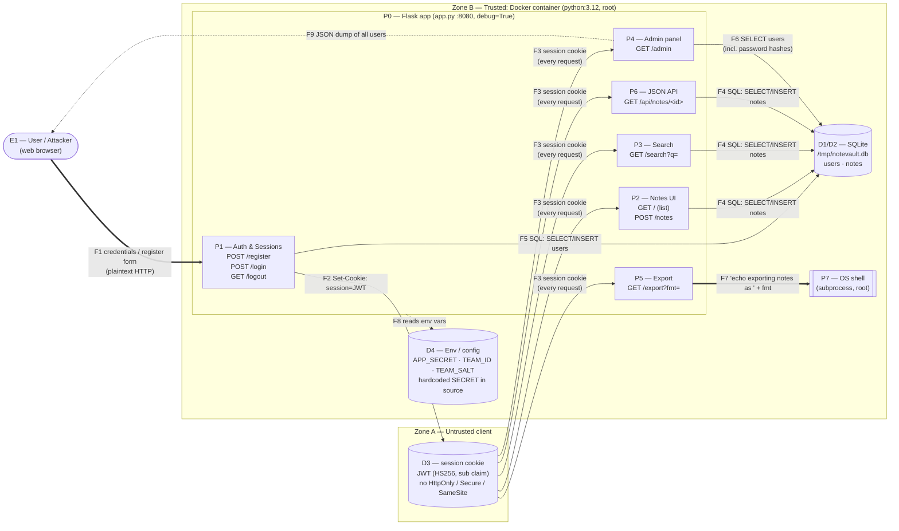

# Data-Flow Diagram — NoteVault

Level-1 DFD of the baseline application. All traffic is **plain HTTP** on port
8080 inside a single Docker container.

## Diagram

`==>` marks flows that cross **trust boundary TB1** (untrusted client → trusted
server). F7 crosses **TB3** (app → OS shell).

## Elements

### External entities
| ID | Entity | Notes |
|---|---|---|
| E1 | User / Attacker | Anyone who can reach `:8080`. Must be treated as hostile — controls every byte of F1/F3. |

### Processes
| ID | Process | Entry points | Notes |
|---|---|---|---|
| P1 | Auth & sessions | `/register`, `/login`, `/logout` | Issues JWT; accepts client-supplied `role`; MD5-hashes passwords; login query built by string formatting |
| P2 | Notes UI | `GET /`, `POST /notes` | Renders note title/body into HTML via `notes_html\|safe` |
| P3 | Search | `GET /search` | `q` and `owner` are string-formatted into SQL |
| P4 | Admin panel | `GET /admin` | Returns **all** users incl. password hashes as JSON |
| P5 | Export | `GET /export` | Concatenates `fmt` into a `shell=True` command |
| P6 | JSON API | `GET /api/notes/<id>` | Fetches a note by id; no ownership check |
| P7 | OS shell | via `subprocess` | Runs as **root** inside the container |

### Data stores
| ID | Store | Contents | Notes |
|---|---|---|---|
| D1 | `users` table | username, MD5 password hash, role | Weak unsalted MD5 |
| D2 | `notes` table | owner, title, body | Contains admin's `infra` secret note + per-team `build-tag` marker |
| D3 | session cookie | JWT `{sub}` | Signed with hardcoded `SECRET` — HS256 forgery verified; `alg=none` whitelisted but rejected by PyJWT's key-guard; no cookie flags; no expiry |
| D4 | env / config | `APP_SECRET` (baked into image), `TEAM_ID`, `TEAM_SALT`, `SECRET` constant | Secrets in image layers / source |

### Trust boundaries
| ID | Boundary | Crossed by | Why it matters |
|---|---|---|---|
| TB1 | Client ↔ server (HTTP :8080) | F1, F3, F7 input, F9 | Every request field is attacker-controlled; traffic is unencrypted |
| TB2 | App ↔ SQLite file | F4, F5, F6 | Query strings are built with attacker input → SQL injection crosses this boundary |
| TB3 | App ↔ OS shell | F7 | Attacker input reaches `shell=True` → command execution as root |
| TB4 | Container ↔ host / image | D4, runtime | Root process, baked-in secrets, unpinned base image, `debug=True` |

## Data flows
| ID | Flow | Data | Boundary |
|---|---|---|---|
| F1 | Browser → P1 | username, password, role | TB1 |
| F2 | P1 → cookie | JWT `{sub}` | TB1 |
| F3 | cookie → P2–P6 | session token | TB1 |
| F4 | P2/P3/P6 → DB | notes SELECT/INSERT (raw `q`) | TB2 |
| F5 | P1 → DB | users SELECT/INSERT (raw username) | TB2 |
| F6 | P4 → DB | SELECT all users incl. hashes | TB2 |
| F7 | P5 → shell | command string with `fmt` | TB3 |
| F8 | app → env | APP_SECRET, TEAM_ID, TEAM_SALT | TB4 |
| F9 | P4 → browser | JSON dump of users + hashes | TB1 |
